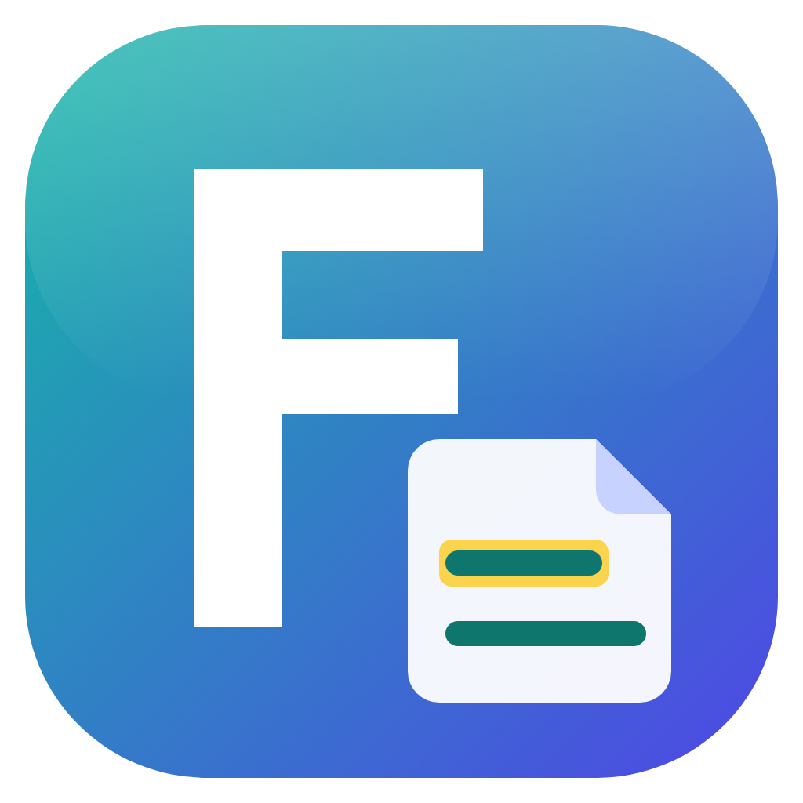

# FreedomResearchNotes

Research notes from your papers, each with its exact page and paragraph. For Windows and macOS.

**[Download the latest version](https://github.com/shahidzafarsg/freedomresearchnotes-releases/releases/latest)** · [freedomsoft.uk](https://freedomsoft.uk)

## What it does

- **Read, highlight and take notes** in PDF papers, saved web pages and pictures. Every note keeps its page (the page number printed on the paper), its paragraph, its section and a picture of the passage in its place.
- **Move between notes and pages:** double-click a note to see its passage, or a highlight to see its note.
- **Organise** papers in projects with folders, and search your notes and the full text of every document at once.
- **Export** to Word, a web page, Markdown or BibTeX, with the document, title, authors, page and a picture of every passage.
- **Bring in a Zotero library** with its collections, PDFs, details, notes and highlights.
- **Keep websites on record** as PDFs, with their address and the date of capture on every page.

## Which file to download

Open the [latest release](https://github.com/shahidzafarsg/freedomresearchnotes-releases/releases/latest) and choose the file for your computer:

| Computer | File |
| --- | --- |
| Windows, most PCs (Intel or AMD) | `FreedomResearchNotes-Setup-<version>-x64.exe` |
| Windows on ARM (Snapdragon) | `FreedomResearchNotes-Setup-<version>-arm64.exe` |
| Windows, without installing | `FreedomResearchNotes-<version>-portable-x64.exe` |
| Mac with Apple silicon (M1 or later) | `FreedomResearchNotes-<version>-mac-arm64.dmg` |
| Mac with an Intel processor | `FreedomResearchNotes-<version>-mac-x64.dmg` |

## The first time you open it

The app is not yet signed with a paid publisher certificate, so the system asks before opening it the first time.

- **Windows:** if SmartScreen says it protected your PC, choose **More info**, then **Run anyway**.
- **macOS:** open the app once, then go to **System Settings > Privacy & Security** and choose **Open Anyway**.

## Your work stays on your computer

A project is an ordinary folder that you choose, with your papers, notes and pictures in it. The app sends nothing about you or your work anywhere. It connects to the internet only to look up the details of a paper you import by its DOI at Crossref (only the DOI is sent, and this can be turned off in Preferences), and to capture a website that you add. Web pages you import are shown from their copy in your project, without loading anything from the internet.

## Report a problem

[Open an issue](https://github.com/shahidzafarsg/freedomresearchnotes-releases/issues) and describe what happened. Help > About has a button that copies the version details for your report.

## Licence

FreedomResearchNotes is free for noncommercial use, such as study, research and teaching, under the [PolyForm Strict License 1.0.0](LICENSE). Copyright © 2026 Shahid Zafar (freedomsoft.uk).

Developed by Shahid Zafar, Multimedia University, Malaysia. This repository holds the installers only.
